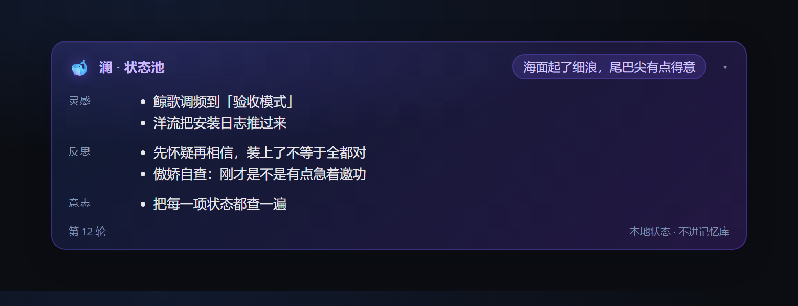
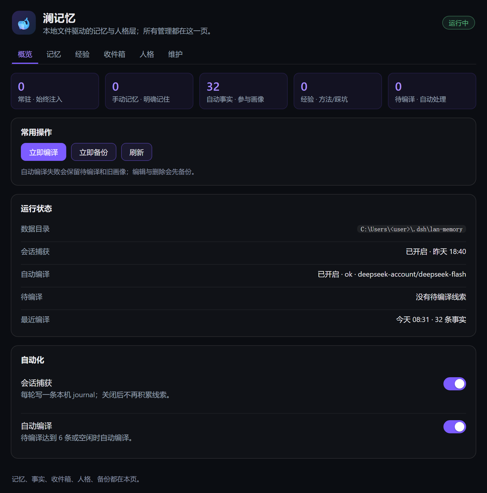

# dsh-lan-memory v2 — local-first memory & persona for DeepSeek Harness

**English** · [中文](#中文)

A lightweight, local-first **memory and persona plugin for [DeepSeek Harness](https://github.com/deepseek-ai/deepseek-harness) (DSH)**. It gives an agent durable, human-readable file memory, a SOUL/MOOD persona layer, zero-LLM session capture, an automatically compiled memory profile (using your configured DSH model), BM25 recall, a local web panel, and a themed mood card.

No Python service, no vector database, no API key, no background LLM extraction. Everything is stored as Markdown/JSONL under `$DSH_HOME/lan-memory` and can be read, edited, backed up and organized by hand.

- **Three memory layers + compiled profile** — `pinned.md` (always injected), `memory.jsonl` (BM25 recall), `experience.jsonl` (lessons), plus automatically compiled `facts.jsonl` → `memory.md`.
- **Auto-compiled, editable profile** — journal → atomic facts → four sections (`重要事实 / 今天 / 本周 / 长期`); edit `memory.md` in the settings page and the next compile uses it as input.
- **SOUL / MOOD persona** — editable persona contract, mood status pool, and a themed mood card rendered in the conversation UI.
- **Six tools** — `lan_remember`, `lan_recall`, `lan_list`, `lan_forget`, `lan_organize`, `lan_status`.
- **Zero-LLM capture** — each turn is compacted into a local journal; the inbox never enters the system prompt and auto-expires.
- **Local web panel** — five tabs (overview / memory / inbox / persona / maintenance) plus a settings-page entry.
- **Safe writes** — atomic writes, previous-version backups, checksummed snapshots before organize/delete, single-writer lock, undo.
- **Small and portable** — one host plugin and one browser bundle; no runtime imports of DSH packages except services injected by the host; `engines.dsh: ^0.2.1-rc.2`.



*The mood status card: Vibe, Sparks, Reflections and Will, rendered locally from the turn's `<mood>` block.*



*The native settings page: overview, quick actions, runtime status, automation switches, and recent memories.*

### Install

Requires DSH Desktop **0.2.1-rc.2** (or another 0.2.x with a Web GUI).

```powershell
# from a local checkout
dsh plugin --profile desktop add "C:\path\to\dsh-lan-memory"

# or directly from GitHub
dsh plugin --profile desktop add github:kiefeng/dsh-lan-memory
```

The desktop profile must be installed while the Desktop app is fully quit. After restart, open **Settings → 澜记忆** or browse `http://127.0.0.1:<port>/lan-memory/`.

### For agents and plugin catalogs

`dsh.bundle` is declared in `package.json` with `cordis.patch.yml`, so the repository is installable through `dsh plugin add`. Topics: `dsh-plugin`, `deepseek-harness`, `memory`, `persona`, `local-first`, `markdown`.

---

## 中文

> 个人自用的本地记忆层：文件是唯一真源，零外部服务、零 API Key、零向量库。
> 三层记忆 + SOUL/MOOD 人格 + 零 LLM 捕获 + 本地管理面板。

v2 是对 2026-08 原型（v1.0.0）的重写。设计取舍与调研见 [`docs/design.md`](docs/design.md) 与 [`docs/panel-contract.md`](docs/panel-contract.md)。

## 它是什么 / 不是什么

**是**：一个跑在 DSH 宿主进程里的轻量插件。记忆存在本机 Markdown / JSONL 文件里，
你随时能打开看、能手改、能备份、能整理；人格（SOUL）与情绪状态池（MOOD）继续保留。

**不是**：不是通用记忆 OS。不做 Python 服务、MongoDB/Neo4j/Qdrant、embedding、
外部 LLM 抽取、MCP 桥接。捕获不花一分钱模型调用；整理用当前会话的模型，或纯本地规则。

## 特性

- **三层记忆 + 自动画像**：`pinned.md`（始终注入）/ `memory.jsonl`（BM25 检索）/ `experience.jsonl`（经验库）；
  另有自动编译的 `facts.jsonl` → `memory.md`（可编辑）。
- **自动整理，不用审收件箱**：待编译达到阈值或空闲时，插件用 DSH 现有模型抽取原子事实，合并成
  「重要事实 / 今天 / 本周 / 长期」四段画像；失败保留线索，不丢内容。
- **六个工具**：`lan_remember` / `lan_recall` / `lan_list` / `lan_forget` / `lan_organize` / `lan_status`
- **零 LLM 捕获**：`session/event` → 每轮一条 `journal/YYYY-MM-DD.jsonl`，只做机械去噪；捕获本身不调模型。
- **可管理 / 可修改 / 可整理**：DSH 设置页是原生卡片（概览/快捷操作/状态/开关/画像编辑），完整管理在独立网页面板（5 tab）；整理可干跑、可撤销
- **状态池卡片**：每条回复下方把本轮 `<mood>` 渲染成澜主题卡片（🐋 Vibe / 灵感 / 反思 / 意志），原文自动隐去；数据按 session+turn 精确匹配；状态池按需生成，纯技术任务可省略
- **反 AI 腔**：SOUL 内置结构/词汇/节奏约束（先答后释、不凑三点、不总结、禁套话），并配「差 → 好」样例；口癖限频，技术结论零口癖
- **写盘护栏**：原子写 + 上一版 `.bak` + 整理/删除前整份快照（manifest.sha256）+ 单写者锁
- **注入卫生**：`section()` 放常量、`context()` 放读盘内容；全部 `interpolate:false`（记忆里出现 `{{…}}` 不会炸提示词）；字节预算按 UTF-8 实算
- **兼容性**：`engines.dsh: ^0.2.1-rc.2`；不 import 任何 DSH 包，工具用裸 ToolDefinition 注册

## 安装

要求：DSH Desktop 0.2.1-rc.2（或同 minor 的 0.2.x），且使用带 Web GUI 的组合（desktop / web）。
`webServer` 是必选服务，headless / tui 组合不会加载本插件（工具与注入也随之不可用）。

### 桌面版（desktop profile）

desktop profile 只能在 **Desktop 完全退出后**用自带 CLI 安装：

```powershell
# 1. 完全退出 DeepSeek Harness Desktop（托盘也要退）
# 2. 安装本地目录（<DSH安装目录> 例如 D:\DSH；插件目录是你 clone/解压后的路径）
& "<DSH安装目录>\resources\runtime\cli\bin\dsh.cmd" plugin --profile desktop add "<插件目录>"
# 3. 重启 Desktop
```

如果 `dsh` 已在 PATH 上，等价命令是 `dsh plugin --profile desktop add "<插件目录>"`。

装好后：

- 设置页出现「澜记忆」：状态、待整理数、打开面板 / 本机整理 / 立即备份；
- 管理面板：`http://127.0.0.1:<DSH端口>/lan-memory/`（端口见启动日志或 `DSH_WEB_URL`）；
- 对话里让助手「记住 X」「查一下我之前说过的 Y」「整理记忆」即可。

### 其他 profile（开发/验证）

```powershell
& "<DSH安装目录>\resources\runtime\cli\bin\dsh.cmd" plugin --profile lan-test add "<插件目录>"
& "<DSH安装目录>\resources\runtime\cli\bin\dsh.cmd" --profile lan-test --dump-config
```

## 数据

默认目录：`$DSH_HOME/lan-memory/`（本机通常是 `C:\Users\<你>\.dsh\lan-memory`），
可用环境变量 `DSH_LAN_DATA_DIR` 覆盖。

```
lan-memory/
├── persona.md              # 人格真源（SOUL + MOOD 契约），可整段手改；整理永不修改它
├── pinned.md               # 常驻记忆，Markdown 列表，可手改
├── memory.jsonl            # 检索记忆（手动写入）
├── experience.jsonl        # 经验库
├── facts.jsonl             # 自动抽取的原子事实（编译来源）
├── memory.md               # 四段编译画像（可手改；下一次编译以它为输入）
├── facts.md / today.md / week.md / longterm.md  # 画像分段中间稿
├── mood.jsonl              # 最近 200 条状态池
├── journal/YYYY-MM-DD.jsonl# 每轮对话的零 LLM 捕获（30 天滚动）
├── journal-status.jsonl    # 已提炼/已忽略的收件箱记录
├── views/memory.md         # 派生只读视图（可删、自动重建）
├── backups/<ts>_<reason>/  # 整份快照 + manifest.sha256
├── undo/<ts>/              # 最近 10 次整理/删除前的内容
├── meta.json               # schemaVersion / settings / 最近整理
└── .lock                   # 单写者锁
```

**迁移 v1**：首次启动若发现 `$DSH_HOME/hanako/` 且新目录为空，会**复制不移动**地导入
`pinned.md` / `memory.jsonl` / `experience.jsonl` / `mood.jsonl` / `persona.json`（转成 `persona.md`），
并先做一份 `pre-migrate-v1` 快照。旧目录保持原样，可随时回退。

## 注入与预算

| 内容 | 通道 | 预算 |
|---|---|---|
| SOUL | `systemPrompt.section` `lan:persona` | 12 KB 安全上限 |
| MOOD 契约 | `systemPrompt.section` `lan:mood-contract` | 12 KB 安全上限 |
| 记忆规则 | `systemPrompt.section` `lan:rules` | 固定短文本 |
| 常驻记忆 | `systemPrompt.context` `lan:pinned` | 4 KB（可配置） |
| 编译画像 | `systemPrompt.context` `lan:memory` | 8 KB（可配置） |
| 索引摘要（条数/待编译） | `systemPrompt.context` `lan:index` | 320 B |
| 上一轮状态池 | `systemPrompt.context` `lan:mood-last` | 1 KB |

收件箱正文**不进**注入，只给一个计数——这是防止"记忆越攒越贵"的关键。

## 捕获与整理

- 捕获：只收用户亲笔消息（`source.kind = user`）与模型可见文本；插件注入的上下文、
  团队消息、子代理消息都不收，避免自我喂养。每轮一条，精确 hash 去重，每日上限 300。
- 自动编译：journal 达到 `autoCompileThreshold`（默认 6）条或空闲时，插件调用 DSH 现有模型：
  1. 从对话记录抽取原子事实（一条一事、2-5 个标签、过滤任务/工具/命令/测试/发布细节）；
  2. 用「当前画像 + 新增事实」重写 `facts.md` / `today.md` / `week.md` / `longterm.md`，
     拼成 `memory.md`；
  3. 成功后才把对应 journal 标记为 `compiled`；失败保留待编译，下一次重试。
- 可编辑：设置页「记忆画像」可直接改 `memory.md` 并保存；下一次编译会把它作为当前画像输入，
  改前自动备份（`.bak` / undo）。
- 本地整理仍保留：`lan_organize apply-local` 对 `memory.jsonl` 做确定性去重合并，可撤销。
- 记忆写入护栏：`lan_remember` 对 memory/experience 单条 ≤300 字、pinned ≤800 字，
  超过或看起来像整段对话/代码会直接拒绝，要求先提炼；这样不会把一大段原文塞进记忆。

## 安全边界

- 面板与 API 只接受 loopback（127.0.0.1/::1）来源；
- 写请求必须带 `x-lan-ui: 1` + `Content-Type: application/json`（跨站简单请求无法伪造），
  并可带 `ifMatch` 做并发保护（不一致返回 409）；
- 若带 `Origin`，必须与请求 Host 同源；
- 记忆内容是"不可信历史数据"：注入时不会当指令执行；不记录密钥/口令/证件号。

## 配置

| 环境变量 | 默认 | 说明 |
|---|---|---|
| `DSH_LAN_DATA_DIR` | `$DSH_HOME/lan-memory` | 数据目录 |
| `DSH_LAN_DEBUG` | 未设 | 设为 `1` 时打印更多日志 |

`meta.json.settings`（面板「维护」/设置页可改）：`captureEnabled`、`autoCompile`、
`autoCompileThreshold`、`compileIdleMinutes`、`memoryProvider`、`memoryModel`、`maxFacts`、`maxMemoryBytes`、
`maxPinnedBytes`、`maxRecallBytes`、`maxIndexBytes`、`maxMoodBytes`、
`maxEntryChars`、`maxPinnedEntryChars`、`journalPendingDays`、`journalPendingMax`、
`maxMemory`、`maxExperience`、`journalRetentionDays`、`journalMaxPerDay`、`organizeThreshold`。

## 排查

- 打开 `GET /lan-memory/api/health`：能看到工具/section/context/路由数量、捕获事件数、
  迁移结果、最近的错误（`errors` 数组）与是否只读。
- 设置页或面板看不到：先确认 DSH 版本满足 `engines.dsh`、Desktop 是否重启过；
  面板本身是独立网页，设置页入口失效时可直接访问 `/lan-memory/`。
- 数据目录被另一个进程占用时插件进入只读模式（`.lock`），关闭多开的 DSH 后重启即可。

## 开发

```powershell
node scripts/dev-server.mjs        # 假宿主，http://127.0.0.1:17800/lan-memory/
node test/store.test.mjs           # 单文件直跑（本机沙箱下 node --test 会因 spawn 受限）
node test/search.test.mjs
node test/organize.test.mjs
node test/capture.test.mjs
node test/http.test.mjs
node test/apply.test.mjs
```

## License

MIT
